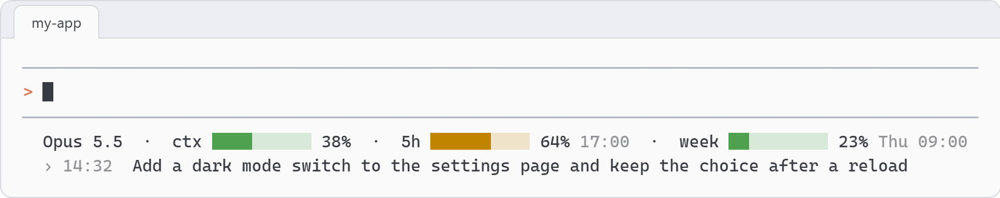
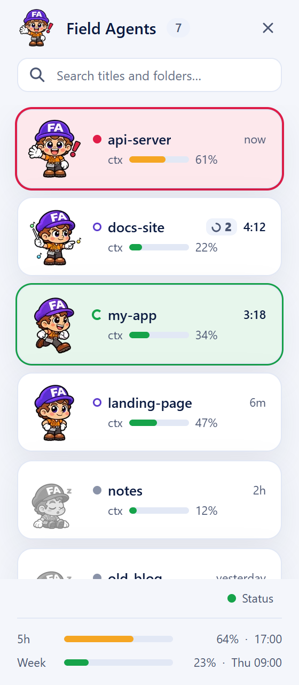
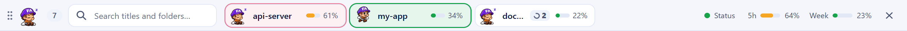
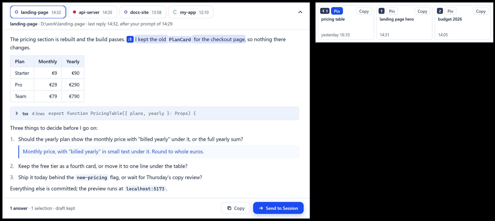

<p align="center"></p>

# claude-plus-fa

Add-ons for [Claude Code](https://code.claude.com) on Windows, so a long session and its context are never lost.

- It works through Claude Code's own hooks and status line; Claude Code itself is never changed.
- An independent project, not made or endorsed by Anthropic.

## What you get

### Status line



- The model, how full the context is, and your 5-hour and weekly usage with their reset times.
- Bars are green under 50 %, yellow under 80 %, red above.
- The second line shows your last prompt in full (up to 12 lines), so you never scroll up to find it.

### Nothing lost at compaction

- At 90 % context, well before Claude Code compacts on its own, Claude commits the finished work, updates the project's `memory.md` and writes a `handoff.md` saying where the work stands and what comes next.
- Right after a compaction, Claude reads `handoff.md` and `memory.md` back and tells you which files it read.
- A new session in a project that has a `handoff.md` starts by reading it.

### Usage limit: carry on with GLM or Codex


- When your Claude limit runs out, this window offers to continue the session in a new window, from where it stopped. It comes once per session, named like it; subagents and `claude -p` runs never open one.
- **Continue With GLM**: free models from [z.ai](https://z.ai) (GLM-4.7-Flash, GLM-4.5-Flash). It keeps writing into the same conversation, in a window of its own named like the session. Needs a free z.ai key (see below).
- **Continue With Codex**: OpenAI's coding agent on your ChatGPT plan. The conversation moves to a Codex thread with its full history, in a window of its own named like the session. Codex is told to read your `CLAUDE.md` files and follow them. It opens in the session's folder without stopping on a question: the folder is marked trusted in Codex, as its own **Trust and continue** would do, unless you already answered that for it. Once GLM or Codex runs, the old Claude window closes (not while it still runs background work).
- Whatever is not ready yet shows **Set Up GLM** or **Set Up Codex**, with a button for each step. The window notices each finished step by itself.


- When the limit resets, Field Agents waits for GLM or Codex to finish its turn, then offers to bring the session back to Claude. Coming back from Codex, Claude first gets a record of everything Codex did, so the Claude conversation stays one piece.
- Close the GLM or Codex window and the session comes back to Claude by itself (from Codex with that record). After Codex, before the limit resets, Claude Code waits and goes on when it does.
- To go back any time, right-click the session in Field Agents and pick **Back to Claude**.
- The `glm` command runs Claude Code on GLM by hand, with your usual sessions and settings: `glm`, or `glm --resume <session>`.

### Field Agents



Every Claude Code session on your PC in one list on the right edge of the screen, newest first, with a search box: each session is an agent at work in the field, hence the name (it was called Agent Panel before). It takes no screen space: the window you work in covers it.

- **Red**: the session asks you something. It stays at the top; a permission prompt makes its card pulse.
- **Green**: the session is working, or work it started still runs in the background. Its dot turns while the session itself works, and the clock shows how long the current turn has run.
- **Turning badge**: work the session started in the background (a subagent or a `claude -p` run), with the number of runs.
- **Purple**: open and waiting for you. **Grey**: closed.
- The hero on each card shows what its session is doing: it waves when the session asks you something, conducts while background work runs, runs while the session works, stands while it is open and sleeps when it is closed. Now and then it glances at you.
- **Rest the pointer on a card** and it opens downward to show what its session is working on: every subagent, Workflow agent, `claude -p` run and background command still running, grouped under the prompt you typed that set it off, newest prompt first, each with how long it has run (*14 min*). Agents are numbered *Agent 1*, *Agent 2*, ...; a Workflow's agents sit together under one *Workflow* line with its name. Your last prompt comes first, alone when it started nothing still running. When they do not all fit, click *and n more* for a column of them all beside the panel.
- Each card shows how full that session's context is. The bottom shows your 5-hour and weekly usage.

Using it:
- Click an open session to bring its window to the front, even from the notification area (Windows Terminal's **Hide Terminal in the notification area when it is minimized**). Click it again to put it away.
- With that Windows Terminal setting on, only the terminal in front keeps a taskbar button: whenever a Windows Terminal window comes to the front (a card, the taskbar, Alt+Tab, a click), the other Windows Terminal windows go to the notification area, still running, and come back from their cards.
- A link you Ctrl+click in a session's terminal opens in front, even when Windows would leave the browser or editor behind the terminal.
- Double-click a closed session to open it in its own folder, in a new terminal, as `claude --resume <session> --dangerously-skip-permissions`.
- Right-click a session to **Hide** it, **Close** it, or **Delete** it (its conversation goes to the Recycle Bin; your project files are never touched).
- Hidden sessions, sessions whose folder is gone and `claude -p` runs are listed under **Hidden, Deleted and Headless** at the bottom. A finished `claude -p` run leaves the panel 24 hours after it last changed (`"headless_hours"` in `~/.claude/claude-plus.local.json` changes this); its conversation stays on disk.
- Open or hide the panel with `Ctrl+Alt+C`, its tray icon, or the **Field Agents** icon on your desktop. It starts when you sign in to Windows.
- The tray icon shows your 5-hour usage as a number. Clicking it also brings back the Claude Code terminal you were last in.
- **Status** opens [status.claude.com](https://status.claude.com/); its dot shows whether Claude has an outage.
- If a Claude Code update breaks `claude`, the panel repairs it with `claude update`.
- Drag the header to the top edge to make it a row of tabs (the tray menu does this too):



When a session starts waiting for your answer, this alert drops in at the top of the screen with three knocks. Click the session to go to it. It never takes the keyboard from what you are typing.


### Reply window

Answer Claude's reply where you read it, paragraph by paragraph.



1. While a Claude Code session is open, the reply window opens at the top left of the screen, beside the screenshot strip, with a tab for each open session. It shows every reply Claude gave since your last prompt in that session, formatted as in the terminal (tables included). It follows the session you last typed in, and the session whose terminal you click or switch to; click a tab to see another.
2. Click a paragraph, a list item or a table. A box opens under it: type your answer. Enter finishes it and leaves the box (the text stays), Shift+Enter starts a new line. Esc works as in Claude Code's prompt: in a box with text the first Esc shows *Press Esc again to clear*, and a second one within 2 seconds empties the box (Ctrl+Z brings the text back); in an empty box Esc leaves it. Tab opens the next block's box (Shift+Tab the previous one) across all replies shown; a box Tab leaves empty closes, one with text stays, and at the last block Tab leaves the box. Click the paragraph again to close an empty box; a box with text stays open. Dragging to select text never opens one. Code blocks show as one line; click one to open it.
3. Click **Send to Session**. The session's terminal comes to the front with each reply you answered pasted in full, with each answer under the passage it answers, led by **My answer to** and that passage's first line, so Claude knows which item it belongs to. Claude Code may show the block as a collapsed paste. Press Enter to send it. Your answers stay in their boxes: press **Send to Session** again to paste the same block once more, for example after deleting it in the terminal by mistake.

- Claude gets each paragraph you answered, with your answer.
- Hold **Space** in an answer box to speak your answer, as in Claude Code: a space appears, then *Listening…* with a level meter; your words appear at the cursor while you speak (the newest ones dim until they settle), and when you let go the rest is filled in. Esc while you speak, or while it is still transcribing, cancels that answer: nothing is put in and the box keeps what it had. A quick tap still types a space. By default Claude Code's own voice input does the listening, in a hidden Claude Code that Field Agents keeps running for this; when it cannot, a local speech-to-text server takes that answer over (see [Dictation](#dictation)). Nothing is kept. When the microphone or the server is missing, the note under the box says so, with a link that helps.
- An empty answer box shows **I approve** at its right end: click it to put that text in the box, then keep typing or press **Send to Session**. It goes once the box holds text. To use your own words, or more than one, put `"quick_answers": ["I approve", "Not now"]` in `~/.claude/claude-plus.local.json` (one button each, in that order; `[]` for none).
- Links work here even when the terminal wraps them: click one to open it. Web links open in your browser; `file:///` links, and Windows paths such as `C:\Users\you\shot.png` that exist on your PC, open with the app Windows uses for that file or folder (a program or script is shown in File Explorer instead of being run). A missing file says *File not found* next to the link.
- Your answers are kept until you type a new prompt in that session, even if you fold the window or restart. To remove one, empty its box.
- With no answer typed, **Copy** and **Send to Session** take the reply as it is.
- Click **Pin** at the top right of a reply to keep it: it becomes a chip under the tabs, still there after newer prompts and restarts. Click the chip to read and answer it again (your answers stay with it as long as it is pinned), **Latest** to go back, its x to unpin it. A session keeps 8 pins.
- **Copy** puts the same line and the paragraphs on the clipboard, to paste anywhere else.
- To copy only part of what is shown, drag anywhere in the replies, on text too, to draw a rectangle. Every block it touches is highlighted whole while you drag; drag past the top or bottom edge to scroll. When you let go, the rectangle disappears and those blocks are already on the clipboard as Claude wrote them (markdown: links, tables and code blocks intact), with a short *Copied* at the corner; the copied blocks stay highlighted for a moment, then fade, so you see what was copied. To change it, drag again. Esc while dragging cancels it. A click still opens the answer box or the link; a double click selects a word and a triple click a paragraph, which Ctrl+C copies. A drag inside an answer box selects its text, and a code block's own scroll bar still scrolls it.
- The same rectangle answers everything in it at once: when you let go, its blocks get one frame and an answer box opens under the last one. Type there, for example *I approve*, and Claude gets those blocks quoted together with your answer under them, marked as one answer to all of them. A block inside the frame can still have its own answer as well. Drag over a framed area again to extend it; leave its box empty to remove it. A rectangle across two replies is only copied.
- The arrow at the top right folds the window to its tabs; click it or a tab to open it again. Drag the tabs' row to move the window and the strip together.
- Send to Session types only into the session's own terminal window, at the cursor. Text already in the prompt stays as it is.
- Codex sessions are not shown.

### Reply to passages

Answer any part of Claude's answer straight from the terminal, without retyping it.


1. Select a question in Claude's answer with the mouse. Do the same for each question you want to answer.
2. Each selection gets a number, shown as `:1`, `:2` where it stands in the reply window (picture above).
3. Type your answers by number: `:1 yes :3 no`. Press Enter.

- Claude gets each passage you answered, with your answer. Passages you skip are not sent.
- With one selection, a prompt that starts with `:` is enough: `: yes, do it`.
- Sending any prompt in that session empties its list.
- `:1` inside backticks, a code block or quotation marks is plain text, and so is `:1` inside a passage you pasted from Claude's reply.
- A passage is cut at 4,000 characters, and Claude is told so.
- The numbered list needs Field Agents running with its strip on. Without it, `: your answer` quotes whatever is on the clipboard.
- The installer turns on Windows Terminal's **Automatically copy selection to clipboard** once. In another terminal, press `Ctrl+C` after selecting.

### Screenshots in one place

- Every screenshot you take (`Win+Shift+S`, Snipping Tool, `PrintScreen`) is saved at once in a `screenshots` folder on your desktop, named after the window and the time.
- Paste one into a Claude Code session and it moves into a `screenshots` folder in that project. The panel adds that folder to the project's `.gitignore`, so it never reaches git.
- The strip at the top (pictures above) shows your last three screenshots and the ones you **Pin**. Click a card to see it large. **Copy** on a card, or **Copy as Text** in the large view, puts the file's path and the text read from the picture on the clipboard, which costs Claude far fewer tokens than the picture. **Copy as Image** in the large view puts the picture itself on the clipboard, to paste into Paint, Word, a browser or a chat app.
- While the panel runs, `Ctrl+V` or `Alt+V` in a Claude Code session pastes a copied picture at once, where the cursor is:


The panel never deletes a screenshot by itself and sends nothing anywhere.

## Requirements

- Windows 10 or 11
- [Claude Code](https://code.claude.com) and Python 3.8 or newer, both on `PATH`
- For GLM only: a free [z.ai API key](https://z.ai/manage-apikey/apikey-list)
- For Codex only: the [Codex CLI](https://github.com/openai/codex), the [Codex plugin for Claude Code](https://github.com/openai/codex-plugin-cc) and a ChatGPT sign-in (**Set Up Codex** walks you through all three)

## Install

Ask Claude Code:

```
Install claude-plus-fa from github.com/firatada/claude-plus-fa.
```

Or by hand:

1. On this page, click **Code**, then **Download ZIP**, and extract it.
2. In the extracted claude-plus-fa folder, double-click `install.cmd`.
3. Restart any open Claude Code session.

To update, double-click `install.cmd` again. It is safe to run as often as you like.

The installer:
- copies the scripts into `~/.claude`, and `glm.cmd` into `~/.local/bin` (added to your `PATH`);
- adds its hooks to `~/.claude/settings.json`, after a backup (`settings.json.before-claude-plus`);
- sets the status line only if you have none;
- creates the z.ai key file `~/.claudex/profiles/glm/.env`;
- turns on Windows Terminal's copy on select once, after a backup;
- installs `pywebview`, `pystray` and `pillow`, starts Field Agents, adds it to Windows sign-in and puts its icon on your desktop.

## Get a free z.ai key

1. Sign up at [z.ai/model-api](https://z.ai/model-api).
2. On the [API Keys](https://z.ai/manage-apikey/apikey-list) page, create a key and copy it.
3. Ask Claude Code:

   ```
   Open the claude-plus-fa z.ai key file ~/.claudex/profiles/glm/.env in Notepad.
   ```

4. Replace `PASTE_YOUR_KEY_HERE` with your key and save. Never paste the key into a chat.

Without a key everything else works; the limit window then shows these steps under **Set Up GLM**.

## Turn things off

Put any of these in `~/.claude/claude-plus.local.json` (the installer never changes this file):

```json
{ "screenshots": false, "paste_keys": false, "shot_strip": false }
```

| Setting | Turns off |
|---|---|
| `"screenshots": false` | Keeping screenshots, the strip and the numbered reply list |
| `"paste_keys": false` | Fast picture paste with `Ctrl+V` and `Alt+V` |
| `"shot_strip": false` | The strip and the numbered reply list (also the picture button in the panel's header) |
| `"minimize_other_terminals": false` | Sending the other Windows Terminal windows to the notification area when one comes to the front |
| `"quick_answers": []` | The **I approve** button in an empty answer box |
| `"rule": "<where your steps live>"` | The built-in 90 % steps: Claude follows yours instead, for example `"the global CLAUDE.md, section \"Saving work\""` |

- The alert and its sound: the panel's tray menu, **Alerts** and **Alert Sound**.
- Field Agents: **Quit** in its tray menu (it starts again at the next sign-in).
- Copy on select: Windows Terminal, **Settings** > **Interaction**. It stays off, even after a reinstall.

## Dictation

Holding **Space** in a reply window answer box goes, by default, to a hidden Claude Code that Field Agents starts for this (no window, no tools, no MCP servers, the small model, in `%LOCALAPPDATA%\claude-plus\voice-host`): its own hold-to-talk records and transcribes, exactly as in a terminal, so it needs Claude Code's voice mode and your Claude sign-in, and the sound goes to Anthropic as it does from any terminal. Nothing is ever submitted in it, so it leaves no session behind; its prompt is emptied after every answer. Field Agents restarts it if it stops and ends it when Field Agents quits. Its log, without your words, is `~/.claude/state/agent-panel/voice.log`.

When the hidden Claude Code is not ready, cannot be read, or reports an error, that answer goes to the speech-to-text server below instead (from the window's own recording, so nothing said is lost), and the log says why. `"dictation": "whisper"` in `~/.claude/claude-plus.local.json` uses the server alone.

The speech-to-text server runs on your own PC: `POST <url>/api/dictate` with a stretch of audio (WAV) as the body and `language` and `prompt` as query parameters, answering `{"text": "..."}` (errors as `{"error": "..."}`); `GET <url>/api/health` answers while it runs. While Space is held the words since the last pause are sent again about every 1.5 s, one request at a time, so words show while you speak; on a CPU-only PC each request takes about 2 to 4 s, so the words come in steps of that size. Set it up in the same `~/.claude/claude-plus.local.json`:

| Setting | Default | What it does |
|---|---|---|
| `"dictation"` | `"claude"` | `"claude"`: Claude Code's own voice input, the server as the fallback; `"whisper"`: the server alone |
| `"dictation_url"` | `"http://127.0.0.1:8765"` | Where the server listens |
| `"dictation_server"` | none | The server's start script; a `.py` or `.pyw` is started hidden when the server is not running |
| `"dictation_app"` | none | What **Open Voice to Text** in a note opens |
| `"dictation_language"` | `"tr"` | The language you speak |
| `"dictation_terms"` | common English developer words, written the first time | Words the server should spell as written (sent as `prompt`); edit the list freely |

## Uninstall

In the claude-plus-fa folder, double-click `uninstall.cmd`.

- It removes its hooks, and the status line if it is this one, after a backup (`settings.json.before-claude-plus-uninstall`).
- It closes Field Agents, removes it from sign-in and the desktop, and deletes the installed scripts.
- It turns copy on select back to how it was, unless you changed it since.
- Your own hooks and status line stay. So do your z.ai key file, `claude-plus.local.json` and your screenshots.
- Restart any open Claude Code session.

## Limits

- Windows only.
- Codex keeps its own conversation. What it did reaches Claude as a record when the session comes back to Claude, never twice.
- After GLM, a session you resume by hand needs `claude --resume <session> --model default`. Field Agents adds this for you.
- Going back to Claude needs Field Agents running, except a resume by hand after Codex.

## License

[MIT](./LICENSE)
