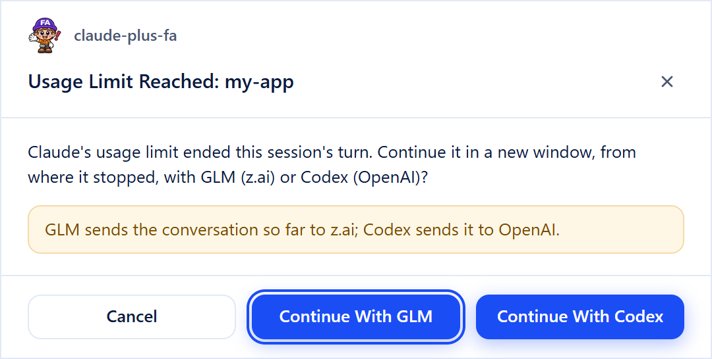
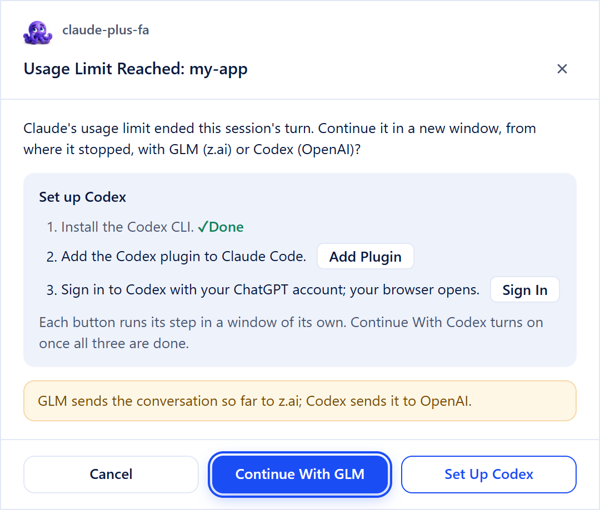
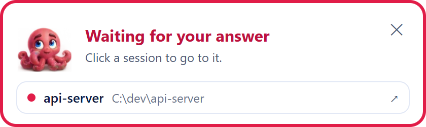
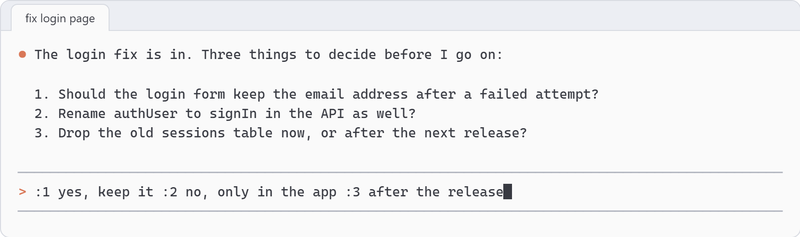
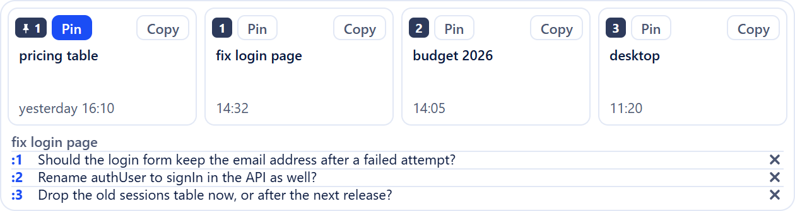
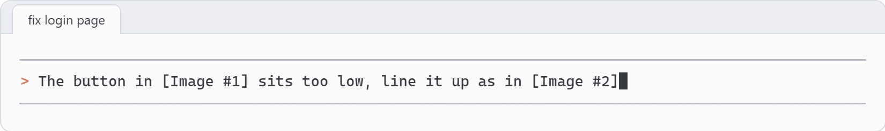

<p align="center"></p>

# claude-plus-fa

Add-ons for [Claude Code](https://code.claude.com) on Windows, so a long session and its context are never lost.

- It works through Claude Code's own hooks and status line; Claude Code itself is never changed.
- An independent project, not made or endorsed by Anthropic.

## What you get

### Status line


- The model, how full the context is, and your 5-hour and weekly usage with their reset times.
- Bars are green under 50 %, yellow under 80 %, red above.
- The second line shows your last prompt in full (up to 12 lines), so you never scroll up to find it.

### Nothing lost at compaction

- At 90 % context, well before Claude Code compacts on its own, Claude commits the finished work, updates the project's `memory.md` and writes a `handoff.md` saying where the work stands and what comes next.
- Right after a compaction, Claude reads `handoff.md` and `memory.md` back and tells you which files it read.
- A new session in a project that has a `handoff.md` starts by reading it.

### Usage limit: carry on with GLM or Codex



- When your Claude limit runs out, this window offers to continue the session in a new window, from where it stopped. It comes once per session, named like it; subagents and `claude -p` runs never open one.
- **Continue With GLM**: free models from [z.ai](https://z.ai) (GLM-4.7-Flash, GLM-4.5-Flash). It keeps writing into the same conversation, in a window of its own named like the session. Needs a free z.ai key (see below).
- **Continue With Codex**: OpenAI's coding agent on your ChatGPT plan. The conversation moves to a Codex thread with its full history, in a window of its own named like the session. Codex is told to read your `CLAUDE.md` files and follow them. It opens in the session's folder without stopping on a question: the folder is marked trusted in Codex, as its own **Trust and continue** would do, unless you already answered that for it. Once GLM or Codex runs, the old Claude window closes (not while it still runs background work).
- Whatever is not ready yet shows **Set Up GLM** or **Set Up Codex**, with a button for each step. The window notices each finished step by itself.



- When the limit resets, Field Agents waits for GLM or Codex to finish its turn, then offers to bring the session back to Claude. Coming back from Codex, Claude first gets a record of everything Codex did, so the Claude conversation stays one piece.
- Close the GLM or Codex window and the session comes back to Claude by itself (from Codex with that record). After Codex, before the limit resets, Claude Code waits and goes on when it does.
- To go back any time, right-click the session in Field Agents and pick **Back to Claude**.
- The `glm` command runs Claude Code on GLM by hand, with your usual sessions and settings: `glm`, or `glm --resume <session>`.

### Field Agents


Every Claude Code session on your PC in one list on the right edge of the screen, newest first, with a search box: each session is an agent at work in the field, hence the name (it was called Agent Panel before). It takes no screen space: the window you work in covers it.

- **Red**: the session asks you something. It stays at the top; a permission prompt makes its card pulse.
- **Green**: the session is working. Its dot turns and the clock shows how long the current turn has run.
- **Turning badge**: work the session started in the background (a subagent or a `claude -p` run), with the number of runs. Point at it to see what they are.
- **Purple**: open and waiting for you. **Grey**: closed.
- Each card shows how full that session's context is. The bottom shows your 5-hour and weekly usage.

Using it:
- Click an open session to bring its window to the front.
- A link you Ctrl+click in a session's terminal opens in front, even when Windows would leave the browser or editor behind the terminal.
- Double-click a closed session to open it in its own folder, in a new terminal, as `claude --resume <session> --dangerously-skip-permissions`.
- Right-click a session to **Hide** it, **Close** it, or **Delete** it (its conversation goes to the Recycle Bin; your project files are never touched).
- Open or hide the panel with `Ctrl+Alt+C`, its tray icon, or the **Field Agents** icon on your desktop. It starts when you sign in to Windows.
- The tray icon shows your 5-hour usage as a number.
- **Status** opens [status.claude.com](https://status.claude.com/); its dot shows whether Claude has an outage.
- If a Claude Code update breaks `claude`, the panel repairs it with `claude update`.
- Drag the header to the top edge to make it a row of tabs (the tray menu does this too):


When a session starts waiting for your answer, this alert drops in at the top of the screen with three knocks. Click the session to go to it. It never takes the keyboard from what you are typing.



### Reply to passages

Answer Claude's questions without retyping them.



1. Select a question in Claude's answer with the mouse. Do the same for each question you want to answer.
2. Each selection joins a numbered list under the screenshot strip, under the name of its session:

   

3. Type your answers by number: `:1 yes :3 no`. Press Enter.

- Claude gets each passage you answered, with your answer. Passages you skip are not sent.
- With one selection, a prompt that starts with `:` is enough: `: yes, do it`.
- Sending any prompt in that session empties its list. The x on a row drops that selection.
- `:1` inside backticks or a code block is plain text.
- A passage is cut at 4,000 characters, and Claude is told so.
- The numbered list needs Field Agents running with its strip on. Without it, `: your answer` quotes whatever is on the clipboard.
- The installer turns on Windows Terminal's **Automatically copy selection to clipboard** once. In another terminal, press `Ctrl+C` after selecting.

### Screenshots in one place

- Every screenshot you take (`Win+Shift+S`, Snipping Tool, `PrintScreen`) is saved at once in a `screenshots` folder on your desktop, named after the window and the time.
- Paste one into a Claude Code session and it moves into a `screenshots` folder in that project. The panel adds that folder to the project's `.gitignore`, so it never reaches git.
- The strip at the top (picture above) shows your last three screenshots and the ones you **Pin**. Click a card to see it large. **Copy** puts the file's path and the text read from the picture on the clipboard, which costs Claude far fewer tokens than the picture.
- While the panel runs, `Ctrl+V` or `Alt+V` in a Claude Code session pastes a copied picture at once, where the cursor is:



The panel never deletes a screenshot by itself and sends nothing anywhere.

## Requirements

- Windows 10 or 11
- [Claude Code](https://code.claude.com) and Python 3.8 or newer, both on `PATH`
- For GLM only: a free [z.ai API key](https://z.ai/manage-apikey/apikey-list)
- For Codex only: the [Codex CLI](https://github.com/openai/codex), the [Codex plugin for Claude Code](https://github.com/openai/codex-plugin-cc) and a ChatGPT sign-in (**Set Up Codex** walks you through all three)

## Install

Ask Claude Code:

```
Install claude-plus-fa from github.com/firatada/claude-plus-fa.
```

Or by hand:

1. On this page, click **Code**, then **Download ZIP**, and extract it.
2. In the extracted claude-plus-fa folder, double-click `install.cmd`.
3. Restart any open Claude Code session.

To update, double-click `install.cmd` again. It is safe to run as often as you like.

The installer:
- copies the scripts into `~/.claude`, and `glm.cmd` into `~/.local/bin` (added to your `PATH`);
- adds its hooks to `~/.claude/settings.json`, after a backup (`settings.json.before-claude-plus`);
- sets the status line only if you have none;
- creates the z.ai key file `~/.claudex/profiles/glm/.env`;
- turns on Windows Terminal's copy on select once, after a backup;
- installs `pywebview`, `pystray` and `pillow`, starts Field Agents, adds it to Windows sign-in and puts its icon on your desktop.

## Get a free z.ai key

1. Sign up at [z.ai/model-api](https://z.ai/model-api).
2. On the [API Keys](https://z.ai/manage-apikey/apikey-list) page, create a key and copy it.
3. Ask Claude Code:

   ```
   Open the claude-plus-fa z.ai key file ~/.claudex/profiles/glm/.env in Notepad.
   ```

4. Replace `PASTE_YOUR_KEY_HERE` with your key and save. Never paste the key into a chat.

Without a key everything else works; the limit window then shows these steps under **Set Up GLM**.

## Turn things off

Put any of these in `~/.claude/claude-plus.local.json` (the installer never changes this file):

```json
{ "screenshots": false, "paste_keys": false, "shot_strip": false }
```

| Setting | Turns off |
|---|---|
| `"screenshots": false` | Keeping screenshots, the strip and the numbered reply list |
| `"paste_keys": false` | Fast picture paste with `Ctrl+V` and `Alt+V` |
| `"shot_strip": false` | The strip and the numbered reply list (also the picture button in the panel's header) |
| `"rule": "<where your steps live>"` | The built-in 90 % steps: Claude follows yours instead, for example `"the global CLAUDE.md, section \"Saving work\""` |

- The alert and its sound: the panel's tray menu, **Alerts** and **Alert Sound**.
- Field Agents: **Quit** in its tray menu (it starts again at the next sign-in).
- Copy on select: Windows Terminal, **Settings** > **Interaction**. It stays off, even after a reinstall.

## Uninstall

In the claude-plus-fa folder, double-click `uninstall.cmd`.

- It removes its hooks, and the status line if it is this one, after a backup (`settings.json.before-claude-plus-uninstall`).
- It closes Field Agents, removes it from sign-in and the desktop, and deletes the installed scripts.
- It turns copy on select back to how it was, unless you changed it since.
- Your own hooks and status line stay. So do your z.ai key file, `claude-plus.local.json` and your screenshots.
- Restart any open Claude Code session.

## Limits

- Windows only.
- Codex keeps its own conversation. What it did reaches Claude as a record when the session comes back to Claude, never twice.
- After GLM, a session you resume by hand needs `claude --resume <session> --model default`. Field Agents adds this for you.
- Going back to Claude needs Field Agents running, except a resume by hand after Codex.

## License

[MIT](./LICENSE)
