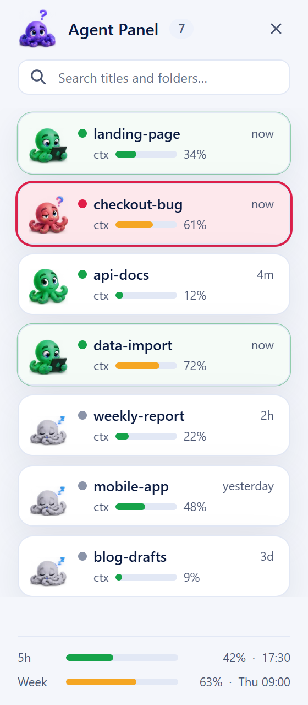

# claude-plus-fa

A set of add-ons that makes [Claude Code](https://code.claude.com) on Windows safer and more pleasant to work with over long sessions.

- Everything runs through Claude Code's own extension points, its hooks and its status line, so Claude Code itself is never modified.
- This is an independent project and is not affiliated with or endorsed by Anthropic.

## What you get


**Status line**
- Shows the active model, how much of the context window is in use, and your 5-hour and weekly usage together with their reset times.
- Each bar changes colour as it fills: green below 50 %, yellow below 80 %, and red above that.

**Last prompt**
- You will be able to see your last prompt here, on the second line, in full: a long prompt wraps over as many lines as it needs, up to 12.
- There is no need to scroll back through a long answer to recall what you asked.

**Context Tracker**
- The status line lets you watch the context yourself, while claude-plus-fa keeps track of it for you in the background at all times.

**Auto Save Before /compact, at 90 %**
- When the context reaches 90 %, well before Claude Code's own auto-compaction at about 97 %, Claude **automatically**:
  - commits the work that is finished and verified;
  - updates the project's `memory.md` with the current state, the decisions taken and the reasons behind them;
  - writes a `handoff.md` that records exactly where the work stands and what comes next.
- As a result, nothing learned during the session is lost when the conversation is compacted.

**After compaction**
- Right after the conversation has been compacted, Claude **automatically** reads `handoff.md` and `memory.md` back, so it continues from the full record instead of the short summary alone.
- Once it has read them, it tells you which `.md` files it read, so you always know what the session is working from.
- The same read-back also takes place when you start a new session in a project that has a `handoff.md`.

**Auto Switch to Free Models When Claude Tokens End**
- When your Claude usage limit runs out, a dialog offers to carry on with a **free** model, GLM by [z.ai](https://z.ai).
- Choosing Yes resumes the very same session, with its full conversation, in a new window.
- **It is completely free!** The models it uses, GLM-4.7-Flash and GLM-4.5-Flash, cost nothing on z.ai.
- The switch requires a free z.ai API key; without one, the dialog never appears.

**Agent Panel**



- Every Claude Code session on your PC, old and current, in a narrow list over the right edge of the screen, newest first, with a search box. It takes no screen space: desktop icons and maximised windows keep their place, and the window you are working in covers it.
- Each session shows its title (point at it to see the session's full folder path) and a `ctx` bar with how much of its context is used, as on the status line. The bottom of the panel shows your `5h` and `week` usage and when each resets. Both come from the claude-plus-fa status line, so a session that never ran with it shows no bar, and a usage figure not reported yet says *no figure yet*.
- Double-click a closed session and it **automatically** opens in its own folder, in a new terminal, as `claude --resume <session> --dangerously-skip-permissions`. Sessions you started from a WSL folder open there too.
- A little octopus sits beside every session, in the colour of the session's dot: green, it reads a tablet while the session works and blinks now and then while it is open; red, it looks puzzled with a question mark when the session asks you something; grey, it sleeps when the session is closed. The one beside the panel's title keeps its own purple.
- A green dot marks an open session and a grey one a closed session. The whole card of a working session slowly glows green, and the card of a session whose window asks you something (a permission prompt) pulses red. A single click on an open session does not start a second copy: it brings that session's window to the front, at the size and place it had (restored if it was minimised).
- It starts **automatically** when you sign in to Windows. `Ctrl+Alt+C` or its tray icon brings it to the front when it is covered, and hides or shows it otherwise.
- Right-click a session to **Hide** it from the list, **Close** it if it is open, or **Delete** it. Hidden sessions, sessions whose folder no longer exists, and headless runs (a `claude -p` that another session started) leave the main list; *Show Hidden, Deleted and Headless* at the bottom of the panel lists them in a section of their own.
- Delete asks once more on the spot (*Yes, Delete*), then moves the session's conversation to the Recycle Bin, so you can restore it. It never touches the files in the project folder (`CLAUDE.md`, `memory.md` and the rest). An open session is closed first; a session stored inside WSL cannot be deleted from the panel.

**Get your free z.ai API key**

It is completely free!

1. Create an account at [z.ai/model-api](https://z.ai/model-api).
2. Go to the [API Keys](https://z.ai/manage-apikey/apikey-list) page and create a new key.
3. Copy the key.
4. Ask Claude Code to open the key file, which the installer created:

```
Open the claude-plus-fa z.ai key file ~/.claudex/profiles/glm/.env in Notepad.
```

5. Replace `PASTE_YOUR_KEY_HERE` with your key and save the file. Never paste the key into a chat.

The key is optional: without it, everything else in claude-plus-fa works as usual.

## Requirements

- Windows 10 or 11
- [Claude Code](https://code.claude.com) and Python 3.8 or newer, both available on `PATH`
- For the free-model switch only: a free [z.ai API key](https://z.ai/manage-apikey/apikey-list)

## Install

The easiest way is to ask Claude Code:

```
Install claude-plus-fa from github.com/firatada/claude-plus-fa.
```

By hand instead:

1. Download the ZIP from this page (Code, Download ZIP) and extract it.
2. Open the extracted claude-plus-fa folder and double-click `install.cmd`.

- If you prefer git, clone the repository instead and double-click `install.cmd` in the cloned folder:

```
git clone https://github.com/firatada/claude-plus-fa
```

- To update, double-click `install.cmd` again; it is safe to run as often as you like.
- Restart any Claude Code session that is already open, since hooks are loaded when a session starts.

The installer:
- copies the scripts into `~/.claude`, and `glm.cmd` into `~/.local/bin`, which it adds to your `PATH`;
- registers the hooks in `~/.claude/settings.json`, after saving a backup as `settings.json.before-claude-plus`;
- sets up the status line only if you do not already have one;
- creates `~/.claudex/profiles/glm/.env`, where you can store the optional z.ai key;
- installs what the Agent Panel needs (`pywebview` for its window, `pystray` for the tray icon), starts the panel and adds it to Windows sign-in.

## Use your own steps

- If you already keep your own procedure for saving work, for example in your `CLAUDE.md`, you can point claude-plus-fa to it in `~/.claude/claude-plus.local.json`:

```json
{ "rule": "the global CLAUDE.md, section \"Saving work before compaction\"" }
```

- Claude will then follow your steps instead of the built-in ones. The installer never modifies this file, so your setting survives every update.

## Uninstall

Open the claude-plus-fa folder and double-click `uninstall.cmd`. If you prefer the terminal, run `.\uninstall.cmd` inside that folder instead.

- It removes the claude-plus-fa hooks from `~/.claude/settings.json`, together with the status line if it is the claude-plus-fa one, after saving a backup as `settings.json.before-claude-plus-uninstall`.
- It closes the Agent Panel, removes it from Windows sign-in, and deletes the installed scripts, `glm.cmd` and the state files claude-plus-fa keeps.
- Your own hooks and your own status line are left untouched.
- Your z.ai key file and `~/.claude/claude-plus.local.json` are kept, in case you reinstall; delete them yourself if you no longer need them.
- Restart any open Claude Code session afterwards.

## Limits

- claude-plus-fa runs on Windows only.

## Files

| File | Role |
|---|---|
| `statusline.py` | Draws the status line and records the context figure |
| `prompt-recall.py` | Keeps your last prompt for the status line |
| `context-guard.py` | Handles the 90 % auto save, the compaction notes and the read-back |
| `glm-fallback.py` | Shows the free-model switch dialog when the usage limit is reached |
| `glm.cmd` | Runs Claude Code on z.ai's GLM models |
| `agent-panel.pyw` | The Agent Panel on the right edge of the screen |
| `agent-panel.html` | The Agent Panel's look (shown in a WebView2 window) |
| `mascot/` | The octopus: the logo (also the tray icon) and the panel's animation strips |
| `tools/mascot-export.py` | Cuts `mascot/` from the octopus sheet in `tools/mascot-source/` |
| `install.cmd`, `install.py` | The installer |
| `uninstall.cmd`, `uninstall.py` | Removes claude-plus-fa in one step |

## License

[MIT](./LICENSE)
